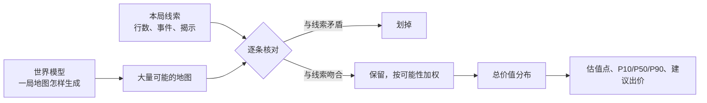
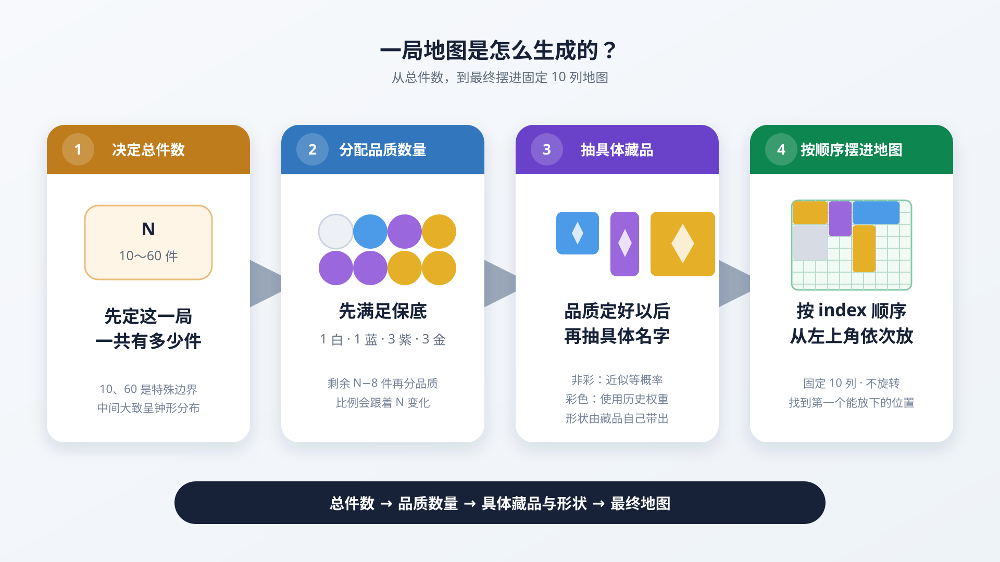

# 竞拍时刻：公开研究档案与实验性估值助手

这是一个面向《碧蓝航线》“竞拍时刻”玩法的公开研究档案。它包含脱敏文本数据、训练与分析代码、冻结模型，以及一个实验性的估值助手：每轮出价前，助手估计**这一局地图上全部藏品的总价值**。助手默认被动抓取模拟器的网络数据作为证据，也可以改用截图 OCR/视觉识别。

> [!IMPORTANT]
> “竞拍时刻”活动已经下线，本项目自 **2026-08-06** 起进入暂时休眠状态。仓库保留用于数据研究、结果复现和未来可能返场时的重新验证，目前不再作为可用的实时活动工具维护。

> [!WARNING]
> 公开实时助手没有在正式活动环境中完成过一整局从开局、逐轮识别与推理到对局结束的端到端跑通验证。现有证据主要覆盖组件测试、冻结数据上的模型研究、脱敏数据发布和界面原型验证。它不是生产系统，预测未经新时间块前瞻校准，所有结果均为人工参考且 `actionable=false`。

项目状态和返场条件分别见 [`STATUS.md`](STATUS.md) 与 [`RETURN_RUNBOOK.md`](RETURN_RUNBOOK.md)，归档资产说明见 [`archive/season-2026-archive-v1.md`](archive/season-2026-archive-v1.md)。

> 冻结助手版本：[latest-model-v6-v2.0.0-beta.6](https://github.com/Ryan00956/auction-moment-research/releases/tag/latest-model-v6-v2.0.0-beta.6)；公开季末快照：[season-2026-archive-v1](https://github.com/Ryan00956/auction-moment-research/releases/tag/season-2026-archive-v1)。`main` 分支还包含归档之后的代码：默认的被动抓包输入和精确条件后验；要复现归档状态，请检出 `season-2026-archive-v1`。

## 一分钟看懂

- **要回答的问题**：这一局所有藏品加起来值多少？
- **线索**：每轮的公共事件和个人事件（例如“金色藏品共 7 件”“2×2 藏品平均价值 33,400”），以及事件揭示的藏品位置、轮廓、品质和身份。
- **证据来源**：默认被动抓包，直接读出游戏发给本机的、出价前可见的事件数据，不需要识别屏幕；也可用 `--input ocr` 改为截图 OCR/YOLO。
- **做法**：先从 1,556 场完整结算中学出“一局地图是怎样生成的”，再只保留与本局全部线索都吻合的可能地图，看它们的总价值分布（详见“预测原理”）。
- **输出**：一个估值点、P10/P50/P90 区间，以及按 P10 计算的保守建议出价。助手不会替你出价。
- **估值器**：默认是“精确条件后验”，冻结的 v6 模型作为对照和回退（`--v6-only` 可只用 v6）。在 74 局、277 份出价前决策的开发回放上，精确条件后验平均误差 15.6%，v6 为 22.5%。这批数据在研发中被反复使用，不是盲测（见“准确度”）。
- **最新研究**：两个更细的生成模型在相同历史回放上，点误差与 v2 基本打平，区间评分改善约 10%。候选参数、模拟生成器和阶段报告已经公开；助手仍使用原来的 v2 先验（见“新研究带来了什么”）。

## 关键发现

研究中最值得记住的结论。每条的出处和局限见后文对应章节。

1. **地图在开局前就已生成，事件只是揭开它。** 用终局地图重算事件的显示值，1,284 局公开对局里各类事件公式的一致率为 99.4–100%；按同样的公式模拟，3,695 个真实事件值复现了 3,692 个。所以每条事件都可以当作关于同一张地图的确定线索。
2. **摆放规则是确定的，地图行数是一把尺子。** 固定 10 列、按顺序找第一个放得下的位置，这条规则逐格复现了全部 50,054 件藏品。所以行数通常是“总占格数 ÷ 10 向上取整”再多 1 行（0–2 行）；总件数约为 2.91 × 行数 − 2.63，平均只差约 2.7 件。
3. **地图行数是最值钱的一条信息。** 只用行数的公式 $`H = 22.07R - 1.10`$ 估计非彩色总价值，误差约 16%；精确模型去掉行数，误差从 15.6% 升到 19.3%。
4. **单条最强的线索是“金色品质总价值”。** $`H = V_G + 8.7175R - 8.39`$ 的误差约 7%，“金色件数 + 紫色件数”的 $`H = 17.5G + 8P`$ 约 8%。其余大多数单条线索比只用行数改进不到 1.5 个百分点（见“速查公式”）。
5. **个人事件选哪个，对估值影响很小。** 在 402 局公开对局的 1,157 份决策上，把每轮三个候选逐一代入精确模型：按事件种类事先定好的“最佳选择”只比实际选择好 0.19 个百分点（95% 区间 −0.55 到 +0.16）。事后看最好和最差的候选各差约 3 个百分点，但哪个更好取决于这局地图本身，事先看不出来（见第 4 节）。
6. **彩色藏品是主要的不确定性。** 彩色平均占整局价值的 32.5%，但没有任何事件直接给出彩色总价。即使给经验估值器全部非彩色身份和彩色件数，误差仍约 13%（只有 1 件彩色时约 20%）。这是强信息对照的实测结果，不是不可突破的数学下界。
7. **小局里的彩色更贵，多件彩色像在分摊预算。** 10–19 件的小局里，彩色单件平均 138 万；50–60 件的大局只有 77 万。4 件彩色的真实总价平均 311 万，按相互独立抽取应为 386 万。
8. **对手的出价帮不上估值。** 对手前几轮的出价与总价值相关（相关系数 0.55），但这部分信息线索里已经有了（与估值残差的相关系数只有 0.07）。在公开数据的 756 份后续轮次决策上，把它加进研究用的梯度提升估值模型，误差变化 +0.14 个百分点（95% 区间 −0.29 到 +0.56）。
9. **把线索合起来用，才会越估越准。** 精确模型的误差从第 1 轮的 16.7% 降到第 5 轮的 11.3%，v6 一直在 20–23%；含“尺寸平均价值”的决策上是 15.6% 对 26.1%。
10. **世界模型抓住了地图的结构。** 用它模拟的 20,000 张地图重新拟合单线索公式，在真实地图上的误差与直接用真实地图拟合的几乎相同（例如金色总价值公式 6.97% 对 6.96%）。
11. **新生成模型的主要收益在区间，而不是点估值。** 同一适配器下，v2、R2、KG_mix2 的局均点误差分别为 15.66%、15.75%、15.60%；两个候选的区间评分改善约 9.9% 和 10.4%。它们支持“整局高总价受到概率抑制”的描述，还不能证明游戏存在 700 万硬上限或特定重抽流程。

## 预测原理

这一节是一份产品说明：先讲要解决什么问题，再讲模型怎样“想象”一局地图、怎样用线索筛选、怎样算出数字，最后用一局公开对局演示估值怎样一轮轮收窄。各条生成规律的完整证据见[藏品生成规律](reports/generation-patterns-v1.md)和[事件刷新规律](reports/event-refresh-patterns-v1.md)。

> **一句话**：助手先学会“一局地图是怎样生成的”，在心里铺开成千上万张可能的地图；每来一条线索，就划掉与它矛盾的地图，剩下的地图按可能性加权；这些地图的总价值分布，就是估值。

### 1. 要解决的问题

每轮出价前，助手要回答：**这一局地图上全部藏品加起来值多少？**（即结算总价值）

难在三点。下面的数字来自 1,284 张经过核对的公开终局地图：

- **价值跨度大**。一局有 10–60 件藏品；单件从白色的 0.1 万到彩色的 306 万不等。整局总价值中间 80% 的对局落在 130–631 万之间，最低 54 万，最高 1,164 万。
- **彩色藏品决定上限**。约 79% 的对局至少有 1 件彩色藏品，彩色平均占整局价值的三分之一。以 9 行的地图为例，非彩色部分的总价值大多在 151–250 万，彩色部分却在 0–334 万之间（均为 P10–P90）。
- **线索零散，单位各不相同**。“紫色共 10 件”“2×3 藏品平均价值 9.27 万”“单格最高价值 19.4 万”……每条线索只照亮地图的一角，人很难把它们合起来换算成总价。

单条公式也不够用。只用地图行数估计非彩色总价值，误差约 16%；有“金色品质总价值”这样的强线索时约 7%（见“速查公式”）。但每条公式只能用一种线索，也给不出彩色部分。所以助手用的是一个能同时用上全部线索的概率模型。

### 2. 核心思路：把“估价”变成“还原地图”



这和侦探排除嫌疑人很像：先列出所有可能的人，每条证据排除一批，再看剩下的人里谁更可能。对应到模型里有三个词：

- **先验**：一条线索都没看到时，对“这局地图长什么样”的判断，由世界模型给出（第 3 节）；
- **条件**：本局已知的线索（第 4 节）；
- **后验**：满足全部条件之后的判断。助手的默认估值器叫“精确条件后验”，因为每一张参与估值的地图都严格满足全部可用线索（第 5 节）。

### 3. 世界模型：一局地图是怎样生成的



世界模型（world-model-v2，发布文件 `world-model-v2-S.json`）把一局地图拆成四个依次发生的步骤。规律来自 1,556 场完整服务器结算、50,054 件藏品。它们是能稳定复现数据的经验规律，不代表看到了游戏源码。

**第 1 步：这一局有多少件（N）**

- N 在 10–60 件之间，但不是均匀的：恰好 10 件约占 8.4%，恰好 60 件约占 6.5%，其余 11–59 件呈中心约 30 件的钟形分布。

**第 2 步：每种品质各几件**

- 每局都有保底：白 1、蓝 1、紫 3、金 3。1,556 场里没有一次例外；如果没有保底、纯随机抽取，本应有约 116 场没有白色。
- 剩下的 N−8 件再分品质，比例随 N 变化：彩色在 10 件的小局里约占剩余件数的 18%，在 60 件的大局里只占约 4%（大局的剩余件数更多，彩色件数不一定更少）。
- 彩色件数比“每件独立掷骰子”更集中，波动大约只有后者的 80%。

**第 3 步：具体是哪一件藏品**

- 白、蓝、紫、金：同一品质内每种藏品机会均等（目录分别有 15、15、20、30 种）。
- 彩色（40 种）：越贵越少见，出现频率与价值的相关系数约 −0.78。助手用的版本还会随总件数调整：**小局里高价彩色相对更常见**。这条关系在前后两段数据的互相检验中都更好，但还没有在新的时间段上复核。
- 形状是藏品自带的属性，不另外抽；同一种藏品可以在一局里重复出现。

**第 4 步：摆进地图**

- 藏品以近似随机的顺序，依次放进固定 10 列的地图：每件都从左上角开始，找第一个放得下的位置，不旋转。
- 这条规则逐格复现了全部 50,054 件藏品的坐标和 1,556 张地图。摆完后最高被占用的那一行，就是开局时告诉玩家的“地图总行数”。
- 所以地图行数不是事先抽出的“容量”，而是摆放的结果：行数约等于总占格数 ÷ 10（向上取整），再多出 0–2 行空隙，最常见的是 1 行。模型正是按这个关系使用行数的。

**这些规律有多可靠**

| 可靠程度 | 内容 |
|---|---|
| 高置信度规则（全部数据无例外） | 品质保底；固定 10 列、按顺序找第一个放得下的位置；行数等于最终最高占用行 |
| 稳定的经验规律（时间留出检验支持） | 总件数分布；剩余品质比例随 N 变化；彩色件数更集中；非彩色等概率、彩色按价值加权；近似随机的摆放顺序 |
| 候选（双向检验更好，待新时间段复核） | 彩色身份权重随总件数变化（助手已采用） |

**已知差距**：在 1,284 张公开终局地图上检查，非彩色部分的件数和身份分布与真实地图一致；总价值略偏高（均值约 420 万，真实约 394 万）。另外，真实地图里多件彩色藏品像是在分摊一个总预算，而模型把它们当作相互独立，所以彩色藏品多时，模型给出的价值波动偏大。

**后续研究**：以上是助手当前使用的 v2 机制。新候选把身份分布细化为训练频率与价格曲线，并加入整局价值权重，以描述彩色共同出现时的相关性；两种候选都保留了超过约 700 万的正概率。它们尚未替换此处的默认先验，详见[阶段报告](reports/world-model-stage-20261027.md)。

**一个旁证**：用世界模型模拟 20,000 张地图，再在模拟地图上重新拟合单线索公式（见“速查公式”），这些公式在真实地图上的误差与直接用真实地图拟合的几乎相同，例如金色总价值公式是 6.97% 对 6.96%。说明世界模型抓住了这些线索与总价值之间的关系。

<details>
<summary>世界模型的完整公式与参数（world-model-v2-S）</summary>

参数直接取自发布文件 `world-model-v2-S.json`。记 $`x = (N - 35)/25`$；$`W`$、$`B`$、$`P`$、$`G`$、$`K`$ 分别代表白、蓝、紫、金、彩。

| 层 | 公式 |
|---|---|
| 总件数 | $`P(N=10)=0.0842`$，$`P(N=60)=0.0649`$；$`11 \le n \le 59`$ 时 $`P(N=n)=0.8509\, w_n / \sum_{k=11}^{59} w_k`$，$`w_n=\exp\left(-\frac{1}{2}\left(\frac{n-29.57}{17.20}\right)^2\right)`$ |
| 品质保底 | 白 1、蓝 1、紫 3、金 3；额外池 $`M = N - 8`$ |
| 额外池的平均品质比例 | $`p_N=\mathrm{softmax}(L_W, L_B, L_P, L_G, 0)`$，$`L_q=a_0+a_1x+a_2x^2+a_3x^3`$ |
| 彩色件数 | 均值为 $`M\cdot p_N(K)`$ 的 Conway–Maxwell 二项分布，$`\nu=1.40`$（$`\nu>1`$ 表示比二项分布更集中） |
| 其余非彩色件数 | 剩下的件数按 $`\mathrm{softmax}(L'_W, L'_B, L'_P, 0)`$ 分到白、蓝、紫、金 |
| 具体身份 | 非彩色：品质内等概率；彩色：$`P(i) \propto v_i^{\,e(N)}`$，$`e(N)=-0.2863-0.4489x`$（不分规模的版本为 $`-0.32`$） |
| 摆放 | 近似随机的顺序；固定 10 列，从左上角起找第一个放得下的位置，不旋转；行数 = 最高占用行 |
| 行数与件数 | $`N \approx 2.913R - 2.63`$（留出平均绝对误差 2.74 件；公开 1,284 张地图上为 2.67 件） |
| 行数与占格 | $`R - \lceil A/10 \rceil`$ 在公开地图上为 0、1、2、3 的分别有 327、799、156、2 张（$`A`$ 为总占格数）；精确模型按这张表使用行数 |

| 系数 | $`a_0`$ | $`a_1`$ | $`a_2`$ | $`a_3`$ |
|---|---:|---:|---:|---:|
| $`L_W`$（白） | 0.3884 | 0.7019 | −0.1980 | 0.0526 |
| $`L_B`$（蓝） | 1.2033 | 0.5728 | −0.3861 | 0.3727 |
| $`L_P`$（紫） | 1.5354 | 0.5380 | −0.2987 | 0.2753 |
| $`L_G`$（金） | 1.5074 | 0.5718 | −0.3209 | 0.1357 |
| $`L'_W`$（白） | −1.118934 | 0.130317 | 0.122754 | −0.083346 |
| $`L'_B`$（蓝） | −0.304177 | 0.001631 | −0.064484 | 0.235453 |
| $`L'_P`$（紫） | 0.028032 | −0.033568 | 0.022486 | 0.138962 |

彩色的 $`L_K`$ 和金色的 $`L'_G`$ 固定为 0，作为比较基准。

</details>

### 4. 线索：从哪里来，说明了什么

**事件怎样出现**

统计来自 4,666 个有完整候选记录的轮次，详见[事件刷新规律](reports/event-refresh-patterns-v1.md)。

- 一共观察到 46 种事件：20 种公共事件（所有人可见），26 种个人事件（每轮从 3 个候选中选 1 个，只有自己可见）。
- 第 1、3、5 轮的公共事件来自同一个池（金色数量、最高单件价值、总占格数等），第 2、4 轮是“显示某规格全部藏品的轮廓”。同一局内公共事件不重复：2,324 次可比较的机会里重复 0 次，如果允许重复，预计应有约 231 次。
- 个人事件的三个候选位置各有自己的小池。第 3、5 轮是固定组合：第 3 轮是随机完整揭示 1 件、随机显示 2 件的位置与品质、随机显示 4 件的位置；第 5 轮是显示全部白色、蓝色、紫色藏品的位置。
- 数量、总价值、平均值这类确定信息，选过一次就不会再出现；随机揭示可以反复出现、反复选择。
- 地图不适用的事件不会出现，例如本局没有 3×3 藏品，就不会出现“显示所有 3×3 藏品的轮廓”。
- 排除这些之后，基本是等概率抽取。唯一的例外是第 4 轮第 1 个候选位置：六个事件的权重约为 7 : 5 : 5 : 5 : 5 : 4，“白色总价值”最常见，“彩色平均占格”最少（p = 0.0027）。
- 模型的工作假设是：地图在开局前已经生成好，事件只揭开它的一部分，不会改变它。用终局地图重算事件显示值，各类事件公式的一致率为 99.4–100%，支持这个假设。

**个人事件该选哪个？影响很小**

在公开数据 08-01、08-02 两天的 402 局（1,157 份决策）上，把每轮实际出现的三个个人候选事件都按真实终局地图模拟出来，分别代入精确模型（单进程，8 秒预算），比较本轮的估值误差：

| 选法 | 平均误差 | 与实际选择相比（百分点） |
|---|---:|---:|
| 实际的选择 | 19.6% | — |
| 三个候选的平均 | 19.5% | −0.16（95% 区间 −0.42 到 +0.10） |
| 按事件种类定好的“最佳选择”（一半对局学，另一半检验） | 19.4% | −0.19（95% 区间 −0.55 到 +0.16） |
| 事后看最好的候选（要先知道答案） | 16.5% | −3.1 |
| 事后看最差的候选 | 22.3% | +2.6 |

- 能事先定下的选择规则几乎没有收益。事后最好与最差的候选相差约 6 个百分点，但哪个更好取决于这局地图本身，事先看不出来。研究中的梯度提升模型也得到同样结论（固定规则 −0.14，事后最好 −1.66）。
- 唯一明显的例外迹象是第 2 轮的“3×3 藏品平均价值”：3×3 的藏品都是彩色，这条线索直接说明了彩色的价值，平均比同轮其他候选好 6.6 个百分点（标准误 2.3），但只出现在 15 份决策里，还需要更多数据确认。
- 这里只比较本轮的估值。这批对局和计算设置都与“准确度”一节不同，19.6% 不能和 15.6% 直接比较，只适合比较不同选法之间的差别。

**默认来源：被动抓包（`--input packet`）**

助手通过 ADB 在已 root 的模拟器里运行 `tcpdump`，只监听游戏的 tcp/8002 连接，在本机内存中解码。它只解码三类出价前就能看到的服务器消息：

- 开局消息：只读地图总行数（玩家信息直接跳过）；
- 每轮公共事件：事件代码、显示值，以及事件揭示的藏品（位置、品质、身份）；
- 本人个人事件的结果：同上。

结算、排名、出价和玩家身份消息不解码，也不保存任何抓包数据。事件代码的含义来自公开数据里的事件目录 `data/v1/core/event_catalog.csv`。这样得到的输入就是模型评估时用的那份结构化数据：地图总行数是精确的，每次随机揭示抽到了哪几件也是确定的，不需要识别屏幕或人工确认。

**可选来源：截图 OCR/YOLO（`--input ocr`）**

- **读事件**：OCR 读出本轮公共事件、个人事件和持有金额，并把事件文字解析成结构化线索。
- **扫地图**：自动滚动整张地图，YOLO 识别每个可见藏品的左上角位置、完整轮廓（宽×高）、品质颜色和完整身份。

两种来源的结果都可以人工修改。证据缺失、置信度不足或线索互相矛盾时，界面会说明缺了什么，而不是给出一个看似精确的数字。

**每类线索怎样变成条件**

| 线索 | 在模型里的含义 |
|---|---|
| “某品质共 n 件”“某规格共 n 件”；“显示所有某品质/某规格的藏品” | 该品质或规格的件数恰好为 n |
| 某品质总价值；某品质平均面积 | 该品质藏品的总价值或平均面积恰好等于显示值（显示值按两位小数截断） |
| 某规格平均价值 | 该规格藏品的平均价值向下取整后恰好等于显示值 |
| 最高品质；单件最高价值；单格最高价值 | 所有藏品都不超过这个上限，且至少有一件恰好达到 |
| 总占格数 | 全部藏品面积之和恰好等于显示值 |
| 最大占格藏品轮廓 | 所有藏品面积都不超过它，且至少一件恰好等于它。抓包直接给出面积；OCR 模式取完整扫描中已知尺寸的最大面积，该轮有轮廓没读出时不用 |
| 随机完整揭示、随机显示品质 | 抽到的身份或品质按“从全部藏品中随机抽到”计算概率：地图里这类藏品越多，越可能抽到它。抓包知道每次抽到了哪几件；OCR 模式只计屏幕上看得出的抽取 |
| 地图总行数 | 按“行数—总占格数”的关系（第 3 节第 4 步）加权。抓包取自开局消息；OCR 模式需勾选“已人工确认到底部” |
| 只显示位置的事件；未被选中的个人候选事件；OCR 模式下自动估算的行数 | 不使用（后验仍然成立，只是信息少一些） |

### 5. 计算：精确条件后验

**为什么不能“随机生成、再筛选”**：以下文实例中的“金色总价值恰好 1,353,224”为例，即使金色件数（8 件）已经对上，随机抽出的 8 件金色藏品总价恰好等于它的概率也只有约 57 万分之一；几条线索叠加后，随机碰上就几乎不可能了。所以模型反过来做：**直接构造满足条件的地图**，同时给每张地图记一个权重，表示它在世界模型里本来有多常见。按权重统计的结果，与“先随机生成、再筛选”在数学上一致，只是快得多。

具体步骤：

1. 先抽各品质件数，使其与数量类线索一致。
2. 在每个品质内部，用逐项累加的查表法（动态规划）直接凑出满足该品质总价值、平均面积等条件的藏品组合。
3. 跨品质的条件（总占格数、规格件数等）由最后一个品质补齐：从它的候选组合里查出正好能补上剩余差额的那一组。
4. 有“尺寸平均价值”时，先逐品质列出该尺寸藏品的所有组合，只抽平均值正好吻合的组合。
5. 随机揭示和地图行数不是硬条件，而是按概率调整权重（见上表）。
6. 所有地图按权重汇总，得到总价值分布。

**速度**

- **并行与预算**：默认 4 个工作进程并行，每次估值预算 8 秒。
- **预热**：抓包模式在本轮公共事件到达时就开始预热；OCR 模式在本轮事件读出后、地图还在滚动扫描时开始。
- **回放耗时**：抓包模式下 277 份决策中位 0.3 秒，最长 7.2 秒。
- **后台细化**：8 秒内没算完的决策标为“有效样本不足”，后台继续最多 45 秒，收敛后自动替换。在回放中，这类决策的估值与不限时计算一样准。

线索不受支持、互相冲突或采样失败时，自动回退到 v6，并在界面说明原因。

另有两种更早的实验模式：`--experimental-v2-fusion` 和 `--experimental-conditional-sampling`。它们都没有通过精度资格验证，说明见[助手说明](apps/ephemeral-assistant/README.md)。

### 6. 一局实例：估值怎样一轮轮收窄

这一局取自公开数据（伪 ID `session_021702fa9dc04d31`），挑选规则事先固定。可用的对局要满足：五轮事件齐全、终局地图通过核对、没有随机身份或品质揭示（公开表不含被抽中的具体藏品）。符合条件的有 20 局，按伪 ID 排序取第一局；伪 ID 是哈希值，相当于随机挑选。地图行数取自终局地图的最高占用行，按摆放规则，它与开局给出的行数相同。

这一局共 28 件（白 3、蓝 6、紫 10、金 8、彩 1），地图 9 行，真实总价值 **308.4 万**。每一步都用本步及之前的全部线索，不限时计算：

| 阶段 | 新增线索 | P10 | P50 | P90 | 估值点 | 估值点误差 |
|---|---|---:|---:|---:|---:|---:|
| 开局前 | 只有世界模型 | 141 万 | 410 万 | 690 万 | 254 万 | −17.7% |
| 开局 | 地图 9 行 | 195 万 | 329 万 | 553 万 | 273 万 | −11.6% |
| 第 1 轮 | 公共：单格最高价值 19.4 万；个人：紫色共 10 件 | 243 万 | 295 万 | 374 万 | 287 万 | −7.1% |
| 第 2 轮 | 公共：3×1 藏品轮廓（共 4 件）；个人：2×3 藏品平均价值 9.27 万 | 254 万 | 307 万 | 386 万 | 299 万 | −3.2% |
| 第 3 轮 | 公共：金色共 8 件；个人：随机显示 4 件位置（不使用） | 277 万 | 309 万 | 384 万 | 305 万 | −0.9% |
| 第 4 轮 | 公共：3×2 藏品轮廓（共 2 件）；个人：紫色平均占 3.40 格 | 275 万 | 306 万 | 384 万 | 303 万 | −1.8% |
| 第 5 轮 | 公共：金色总价值 135.3 万；个人：蓝色位置（共 6 件） | 295 万 | 308 万 | 372 万 | 307 万 | −0.3% |

逐步来看：

- **开局前**：只知道这是一局 S 档地图，区间横跨 141–690 万。
- **知道 9 行**：大局被排除，区间缩到 195–553 万。公开数据里所有 9 行地图的实际总价值是 198 / 289 / 533 万（P10 / P50 / P90），两者接近。
- **第 1 轮**：“单格最高价值 19.4 万”是一个上限：40 种彩色藏品中有 24 种每格价值超过它，全被排除，其中包括全部 8 种 1×1 彩色藏品（最便宜的彩色藏品也值 19.5 万）。P90 从 553 万降到 374 万。
- **第 2–4 轮**：规格轮廓、2×3 平均价值、金色件数、紫色平均占格继续收窄中间部分。随机显示位置的事件不含价值信息，模型不使用。
- **第 5 轮**：“金色总价值”和“蓝色共 6 件”基本锁定了非彩色部分：P10 升到 295 万，估值点 307 万，与真实值只差 0.3%。剩下的区间几乎都在上方（P50 到 P90 还有 64 万），因为模型仍要为可能没被看到的彩色藏品留出余地。

这一局在世界模型的训练时间范围内，误差也比平均小得多，只用来演示过程；整体准确度见下一节。

### 7. 输出：估值点、区间与建议出价

- **P10 / P50 / P90**：后验分布的 10%、50%、90% 分位数。在模型看来，真实总价值低于 P10 的可能约 10%，高于 P90 的可能约 10%。
- **估值点**：精确模式下取“预期百分比误差最小”的点，即按 1/价值加权的后验中位数。同样差 50 万，真实值是 200 万时算错 25%，真实值是 500 万时只算错 10%；所以要让百分比误差最小，估值点会往低处偏，通常略低于 P50。线索少时差得多（上例开局前是 254 万对 410 万），线索多了以后两者接近。
- **建议最高出价**：`P10 × 90%`（可用 `--bid-safety-factor` 调整），并按本轮中标倍率反算对应的对手最高报价。它只是人工参考，助手不会出价。

### 8. 对照与回退：v6 价值模型

v6 是一个统计回归模型，分三层：

1. 按地图行数等特征给出历史基准值；
2. 按几类精确事件以固定比例修正，再按彩色件数和随机揭示的品质做类比修正；
3. 按轮次学习一个有界的对数残差修正。

它快而稳定，但只用了部分线索。它对“尺寸平均价值”这类事件反应偏弱，估值整体偏向历史平均。v6 始终会计算，既作对照，也作精确模式不可用时的回退。

## 准确度：能信多少

开发回放的设置：74 局、277 份出价前决策；输入经助手的抓包解码得到；按对局顺序逐个估值；4 进程，8 秒预算。

| 估值器 | 平均百分比误差 | 其中含“尺寸平均价值”的 109 份 |
|---|---:|---:|
| v6（对照与回退） | 22.5% | 26.1% |
| 精确条件后验（默认） | 15.6% | 15.6% |

按轮次看，精确条件后验随着线索累积而改善，v6 基本不变：

| 轮次 | 决策数 | 精确条件后验 | v6 | P10—P90 宽度（中位数） |
|---|---:|---:|---:|---:|
| 第 1 轮 | 74 | 16.7% | 22.4% | 340 万 |
| 第 2 轮 | 67 | 16.3% | 22.3% | 327 万 |
| 第 3 轮 | 63 | 16.4% | 23.3% | 289 万 |
| 第 4 轮 | 48 | 13.8% | 22.9% | 279 万 |
| 第 5 轮 | 25 | 11.3% | 20.3% | 246 万 |

后几轮的决策更少，各轮不是同一批对局，轮次之间的比较只作参考。

- **抓包模式就是这份输入**：用 74 局记录下的原始消息逐帧走一遍助手的抓包解码，得到的地图行数、事件、揭示藏品和两个模型的输入，在 277 份决策上与评估所用的结构化输入逐项一致，v6 的估值也与冻结记录完全相同。OCR 模式按理想视觉还原的地图回放，误差为 15.5%。
- **差距**：按局平均后，精确模式比 v6 低 6.8 个百分点（95% 区间 2.7–11.1）。
- **区间**：P10—P90 实际覆盖 87.0% 的决策（名义 80%）。
  - 真实值低于 P10 的占 10.5%，与名义值一致，所以按 P10 计算的建议出价是合适的保守值。
  - 高于 P90 的只有 2.5%，说明区间上端偏宽。
- **接近上限**：在公开对局上测算，即使完全知道全部非彩色藏品和彩色件数，只差彩色藏品的具体身份，误差仍约 13%。剩余的不确定性主要来自游戏不公开的彩色藏品信息，所以约 15% 已接近这些线索能达到的水平。

请注意：

- 这 74 局在研发中被反复查看，结果属于开发诊断，**不是盲测**；
- OCR 模式的回放用的是理想转录，**没有模拟真实 OCR 和视觉识别错误**；
- OCR 模式下，只有勾选“已人工确认到底部”后才会使用地图总行数；同一回放去掉行数后，精确模式误差从 15.6% 升到 19.3%。抓包模式不需要这一步；
- 活动已下线，无法在新的时间块上前瞻验证，抓包模式也没有在正式活动中跑过一整局。默认估值器虽已改为精确条件后验，结果仍是未校准的研究估计。

> [!TIP]
> 使用 OCR 模式时，每轮扫描后请核对地图总行数并勾选“已人工确认到底部”（见“确认地图总行数”）。这是 OCR 模式下最值得做的一步人工确认。

## 新研究带来了什么

研究沿着两条线推进：一条让已有线索真正进入推理，另一条检验地图怎样生成。前者的精确约束采样、抓包输入和后台细化已在 main 中；后者现在作为独立研究候选公开。

### 1. 原模型还有什么没解释好？

原 v2 已经能描述总件数、品质保底，以及小局里彩色更贵的总体趋势。它比较粗糙的地方在于：给定规模和品质数后，具体藏品仍独立抽取，因此多件高价彩色同时出现的概率、总价波动和尾部可能偏大。恰好 10 件的小局也有特殊的身份价格分布。

新候选保留两个解释：**R2 先抽规模，再分配品质；KG_mix2 在逐件生成时，根据已有彩色和金色决定是否继续。** 两者都按品质、类型和最终规模抽具体身份，再给高总价的整局较低权重。这样即使基础身份抽取独立，最终留下的彩色也可能表现出“分摊预算”的相关性。

这是可以产生相似数据的概率模型。1,642 局中实际有 30 局超过 700 万，所以研究采用平滑且始终为正的价值权重；没有把“700 万硬上限”“固定重试次数”写成已知游戏规则。

### 2. 收益有多大？

在反复使用过的 74 局、277 个前缀上，用共同适配器比较，先在每局内部平均，再让每局权重相同：

| 指标 | v2 基线 | R2 | KG_mix2 |
|---|---:|---:|---:|
| 点估值误差 MAPE | 15.66% | 15.75% | 15.60% |
| 80% 区间覆盖率 | 87.79% | 84.44% | 83.81% |
| 平均区间宽度 | 268.53 万 | 228.82 万 | 229.04 万 |
| 区间评分，越低越好 | 299.33 万 | 269.77 万 | 268.21 万 |

区间评分同时惩罚“范围太宽”和“真值落在范围外”。候选的范围收窄，漏出惩罚没有抵消这部分收益，因此评分改善约 10%；这不等于点估值准确率或竞拍收益提高 10%。点误差差异的置信区间都跨过零，随机种子改变时排名也会翻转。

这批回放没有超过 700 万的对局，831 个预测中有 119 个尚未达到数值稳定标准，已全部保留在主评分内。生成机制的模拟恢复也不是百分之百：每个模型作为真模型各生成 20 份数据，完整重训后分别认对 14 份和 19 份。它们仍不足以让我们在真实游戏中选定唯一机制。

### 3. 现在适合怎样使用？

**适合发布阶段研究结果，并保留现有助手先验。** 本仓库提供两个候选的参数和只依赖 NumPy 的终局生成器，读者可以生成模拟集合、检查概率和复核汇总统计。完整私有历史回放尚不能仅凭公开文件重跑；公开数据与研究集合重叠，不能算作新验证。

推理改进的过程见[线索与估值报告](reports/inference-development-stage-20261027.md)；新生成机制、负结果、数值限制和复现命令见[世界模型阶段报告](reports/world-model-stage-20261027.md)。下一步等待新时间块和可区分生成顺序的过程证据，不继续用同一批旧局堆叠机制。

## 速查公式：不开助手也能估

作者在研究中为每类事件拟合了一条单线索公式，适合对局中心算。系数只用前期 921 局拟合，再在之后 598 局完整结算地图上复核；下表的主公式也在公开的 1,284 张地图上复算过。

金额单位都是“万”。$`R`$ 为地图行数，$`H`$ 为非彩色（白、蓝、紫、金）总价值，$`T`$ 为整局总价值，$`V_G`$ 为金色总价值，$`G`$、$`P`$ 为金色、紫色件数，$`M`$ 为单件最高价值。

| 已知线索 | 公式 | 误差（598 局复核） | 误差（公开地图复算） |
|---|---|---:|---:|
| 只知道地图行数 | $`H = 22.07R - 1.10`$ | 16.0% | 16.3% |
| 金色品质总价值 | $`H = V_G + 8.7175R - 8.39`$ | 7.0% | 6.9% |
| 金色件数 | $`H = 10.67R + 13.91G - 8.08`$ | 9.6% | 9.5% |
| 金色件数 + 紫色件数 | $`H = 17.5G + 8P`$ | 8.0% | 8.1% |
| 单件最高价值 | $`T = 25.5621R + 1.9131M - 0.002227M^2 - 62.74`$ | 13.7% | 13.5% |

使用时注意：

- 前四条只估非彩色部分 $`H`$。整局总价还要加上彩色部分，而公式给不出彩色；只有“最高品质”不是彩色时，才能确定本局没有彩色，$`T = H`$。
- 同时知道某规格的件数和平均价值时，这个规格的总价被锁定在一个很窄的范围：$`N\bar V \le V < N(\bar V + 0.0001)`$，4,549 次核对没有例外。
- 公开地图与公式的拟合时间段重叠，右列是复算，不是独立检验。
- 这些是中心估值，不是安全出价上限；不知道的量不能当作 0 代入。

以“一局实例”那局为例（9 行；金色 8 件，总价 135.3 万；紫色 10 件）：金色总价值公式给出 205 万，“金色 + 紫色件数”给出 220 万，真实的非彩色总价值是 230.7 万；那件价值 77.7 万的彩色藏品，公式完全算不出来。精确模型把五轮线索合起来，估值 307 万，真实总价值 308.4 万。这只是一局，但能看出把线索合起来用的好处。

<details>
<summary>全部单线索公式（按事件查表）</summary>

更多符号：$`W`$、$`B`$、$`P`$、$`G`$、$`K`$ 为白、蓝、紫、金、彩的件数；$`V_W`$、$`V_B`$、$`V_P`$、$`V_G`$ 为对应品质总价值；$`\bar A`$ 为平均占格数；$`N_{a\times b}`$、$`\bar V_{a\times b}`$ 为该规格的件数和平均价值；$`A`$ 为总占格数；$`L`$ 为最大轮廓的占格数；$`D`$ 为单格最高价值；$`Q`$ 为最高品质（白 1、蓝 2、紫 3、金 4、彩 5）。“终局实测”是公式在 598 局复核地图上的误差，“模型推演”是用世界模型模拟的 20,000 张地图拟合同形公式后，在同一批地图上的误差。

**品质数量与按品质显示位置**

“显示所有某品质藏品的位置”可以直接数出该品质的总件数，因此与对应的品质数量事件共用同一类公式。

| 实战中出现的线索 | 估计对象 | 公式 | 终局实测 MAPE | 模型推演 MAPE |
|---|---|---|---:|---:|
| 显示本局白色品质藏品数量<br>显示所有白色品质藏品的位置 | $`H`$ | $`H=-9.13+22.4820R+3.9037W-0.6171W^2`$ | 15.92% | 15.89% |
| 显示本局蓝色品质藏品数量<br>显示所有蓝色品质藏品的位置 | $`H`$ | $`H=-11.46+22.4102R+3.2652B-0.2532B^2`$ | 15.75% | 15.73% |
| 显示本局紫色品质藏品数量<br>显示所有紫色品质藏品的位置 | $`H`$ | $`H=-20.36+17.7246R+9.5217P-0.2120P^2`$ | 15.27% | 15.25% |
| 显示本局金色品质藏品数量 | $`H`$ | $`H=-8.08+10.67R+13.91G`$ | 9.64% | 9.70% |
| 显示所有金色品质藏品的位置 | $`H`$ | $`H=-3.20+9.96R+14.26G`$ | 9.74% | 9.70% |
| 显示所有彩色品质藏品的位置 | $`T`$ | $`T=-24.60+30.3452R-0.2523R^2+112.8279K-2.7019RK`$ | 19.38% | 19.45% |

若同时已知 $`G`$ 和 $`P`$，优先回到主公式 $`H=17.5G+8P`$。

**品质总价值**

| 实战中出现的线索 | 估计对象 | 公式 | 终局实测 MAPE | 模型推演 MAPE |
|---|---|---|---:|---:|
| 计算本局白色品质藏品总价值 | $`H`$ | $`H=-0.90+21.8854R+V_W`$ | 16.00% | 15.96% |
| 计算本局蓝色品质藏品总价值 | $`H`$ | $`H=-8.62+21.3954R+2.6209V_B-0.0763V_B^2`$ | 15.66% | 15.70% |
| 计算本局紫色品质藏品总价值 | $`H`$ | $`H=3.75+14.7922R+V_P`$ | 15.52% | 15.45% |
| 计算本局金色品质藏品总价值 | $`H`$ | $`H=-8.39+8.7175R+V_G`$ | **6.96%** | **6.97%** |

**品质平均占格数**

| 实战中出现的线索 | 估计对象 | 公式 | 终局实测 MAPE | 模型推演 MAPE |
|---|---|---|---:|---:|
| 计算本局所有白色品质藏品的平均占用格数 | $`H`$ | $`H=-34.00+30.3738R-0.2687R^2-0.8561\bar A_W-0.6095R\bar A_W`$ | 15.60% | 15.48% |
| 计算本局所有蓝色品质藏品的平均占用格数 | $`H`$ | $`H=-42.69+30.7650R-0.2273R^2+4.6711\bar A_B-1.1897R\bar A_B`$ | 15.57% | 15.39% |
| 计算本局所有紫色品质藏品的平均占用格数 | $`H`$ | $`H=34.08+22.1726R-11.4845\bar A_P`$ | 15.40% | 15.45% |
| 计算本局所有金色品质藏品的平均占用格数 | $`H`$ | $`H=0.29+21.8546R+11.7334\bar A_G-3.8888\bar A_G^2`$ | 15.53% | 15.56% |
| 计算本局所有彩色品质藏品的平均占用格数 | $`H`$ | $`H=-37.43+29.7499R-0.2721R^2-2.7018\bar A_K-0.0612R\bar A_K`$ | 14.65% | 14.70% |

彩色平均占格只在本局存在彩色品质时有定义，因此这一行在 476 局适用地图上评分。

**按规格显示轮廓**

以下九条均把该规格数量作为参数；没有该规格的地图按 $`N_{a\times b}=0`$ 计入验证。

| 实战中出现的线索 | 估计对象 | 公式 | 终局实测 MAPE | 模型推演 MAPE |
|---|---|---|---:|---:|
| 显示所有规格为 1×1 的藏品轮廓 | $`H`$ | $`H=0.10+18.8831R+5.7516N_{1\times1}`$ | 14.82% | 14.77% |
| 显示所有规格为 1×2 的藏品轮廓 | $`H`$ | $`H=-2.65+20.2379R+7.0892N_{1\times2}-0.1239N_{1\times2}^2`$ | 14.90% | 14.84% |
| 显示所有规格为 1×3 的藏品轮廓 | $`H`$ | $`H=0.69+20.9513R+3.3773N_{1\times3}`$ | 15.79% | 15.66% |
| 显示所有规格为 2×1 的藏品轮廓 | $`H`$ | $`H=-3.99+19.9940R+10.9645N_{2\times1}-0.4597N_{2\times1}^2`$ | 15.09% | 15.02% |
| 显示所有规格为 2×2 的藏品轮廓 | $`H`$ | $`H=-0.64+21.6493R+0.9950N_{2\times2}`$ | 16.06% | 15.99% |
| 显示所有规格为 2×3 的藏品轮廓 | $`H`$ | $`H=-4.51+24.2711R-6.2715N_{2\times3}`$ | 15.65% | 15.58% |
| 显示所有规格为 3×1 的藏品轮廓 | $`H`$ | $`H=-1.13+20.5723R+5.7867N_{3\times1}`$ | 15.46% | 15.42% |
| 显示所有规格为 3×2 的藏品轮廓 | $`H`$ | $`H=-30.75+26.7076R-0.1246R^2+2.5170N_{3\times2}-0.2618RN_{3\times2}`$ | 15.98% | 15.91% |
| 显示所有规格为 3×3 的藏品轮廓 | $`H`$ | $`H=-0.01+22.3654R-42.0786N_{3\times3}+13.3586N_{3\times3}^2`$ | 15.99% | 15.85% |

**规格平均价值**

规格平均价值本身也可以直接代入。它只在对应规格至少有一件藏品时有定义；适用地图数依次为 1×1：582、1×2：556、1×3：542、2×1：529、2×2：570、2×3：558、3×1：552、3×2：561、3×3：99。

| 实战中出现的线索 | 估计对象 | 公式 | 终局实测 MAPE | 模型推演 MAPE |
|---|---|---|---:|---:|
| 计算本局所有规格为 1×1 的藏品平均价值 | $`H`$ | $`H=-0.57+21.9808R+0.0940\bar V_{1\times1}-0.000608\bar V_{1\times1}^2`$ | 15.62% | 15.59% |
| 计算本局所有规格为 1×2 的藏品平均价值 | $`H`$ | $`H=-3.75+21.7503R+1.2054\bar V_{1\times2}-0.028760\bar V_{1\times2}^2`$ | 15.52% | 15.47% |
| 计算本局所有规格为 1×3 的藏品平均价值 | $`H`$ | $`H=-5.63+22.0557R+0.4673\bar V_{1\times3}`$ | 15.54% | 15.51% |
| 计算本局所有规格为 2×1 的藏品平均价值 | $`H`$ | $`H=0.64+21.8606R+0.1580\bar V_{2\times1}`$ | 14.98% | 15.03% |
| 计算本局所有规格为 2×2 的藏品平均价值 | $`H`$ | $`H=3.54+21.9329R-0.2057\bar V_{2\times2}+0.000387\bar V_{2\times2}^2`$ | 16.06% | 15.94% |
| 计算本局所有规格为 2×3 的藏品平均价值 | $`H`$ | $`H=-1.99+22.1650R-0.05682\bar V_{2\times3}`$ | 15.94% | 15.89% |
| 计算本局所有规格为 3×1 的藏品平均价值 | $`H`$ | $`H=-20.83+21.9243R+2.3535\bar V_{3\times1}-0.030435\bar V_{3\times1}^2`$ | 15.40% | 15.26% |
| 计算本局所有规格为 3×2 的藏品平均价值 | $`H`$ | $`H=-28.01+27.6236R-0.2497R^2-0.4512\bar V_{3\times2}+0.05014R\bar V_{3\times2}`$ | 15.86% | 15.61% |
| 计算本局所有规格为 3×3 的藏品平均价值 | $`H`$ | $`H=-5.59+20.7283R-0.006932\bar V_{3\times3}`$ | 14.36% | 14.50% |

**其他全局条件**

| 实战中出现的线索 | 估计对象 | 公式或规则 | 终局实测 MAPE | 模型推演 MAPE |
|---|---|---|---:|---:|
| 计算本局所有藏品的总占格数 | $`H`$ | $`H=22.767+2.2648A`$ | 15.03% | 14.91% |
| 显示本局占格数最多的藏品轮廓 | $`H`$ | $`H=-9.13+30.4981R-0.2118R^2-3.6934L-0.4291RL`$ | 15.74% | — |
| 显示本局单件价值最高的藏品价值 | $`T`$ | $`T=-62.74+25.5621R+1.9131M-0.002227M^2`$ | 13.70% | 14.35% |
| 显示本局单个单位格最高价值 | $`H`$ | $`H=0.05+22.0901R-0.031406D`$ | 16.01% | 15.96% |
| 显示本局藏品的最高品质 | $`H`$ | $`H=68.32+22.4631R-15.4143Q`$ | 15.99% | 15.88% |

“最高品质”不是彩色（$`Q<5`$）时本局没有彩色，$`T=H`$；598 局里没有反例。

随机揭示和只显示位置的事件没有稳定的专属公式，先用只知道行数的 $`H = 22.07R - 1.10`$；随机完整揭示的藏品价值可以作为已知部分。

</details>

## 实验性助手包含的组件

下面是已经实现的原型组件，不代表它们已在一整局正式活动中端到端跑通：

- **被动抓包（默认）**：从开局消息起跟踪本局，每轮个人事件结果一到就生成预测；只解码出价前可见的三类消息。
- **自动监视对局（OCR 模式）**：大厅待机，检测开局后进入轮次状态机，每轮自动扫描一次地图并生成预测。
- **OCR 事件识别**：识别轮次、公共事件、个人事件和持有金额，支持逐项人工修改。
- **YOLO 地图识别**：识别藏品位置、完整形状、品质、规格和完整身份候选。
- **可视化地图建模**：在网格上拖拽新增、移动或删除藏品框，快速补充 OCR 漏掉的信息。
- **中文藏品图鉴**：内置 120 个藏品的名称和预览图，可按品质与尺寸筛选并确认身份。
- **估值与建议出价**：默认精确条件后验（v6 对照与回退）、P10/P50/P90 区间，以及保守建议出价。
- **条件冲突诊断**：条件不兼容时指出造成冲突的事件或地图证据。
- **完整运行日志**：可滚动、选择复制或一键复制全部，包含 OCR、地图快照、推理状态和异常详情。

界面左侧是地图建模与快速纠错，右侧是事件、证据、预测与日志。两种模式按下面的流程设计，但完整链路尚未在正式活动环境完成一整局验证：

```text
抓包：开局消息 → 公共事件到达（开始预热）→ 个人事件结果到达 → 生成预测 → 等待下一轮
OCR： 大厅等待 → 检测开局 → 识别事件 → 扫描本轮地图 → 生成预测 → 等待下一轮
```

## 复现实验性助手

活动已下线，以下步骤只用于复现、审阅或未来返场后的重新验证，不构成当前可用性承诺。

### 1. 准备环境

- Windows 10 或 Windows 11
- Python 3.11 或 Python 3.12
- Git
- 可用的 ADB
- 抓包模式（默认）：模拟器需开启 root ADB，并且模拟器内有 `tcpdump`；游戏流量默认走 `wlan0` 网卡
- OCR 模式：模拟器使用 `1280×720` 横屏分辨率；程序会优先使用 CUDA，没有可用显卡时也可以使用 CPU，只是视觉识别会慢一些

### 2. 下载并安装

```powershell
git clone https://github.com/Ryan00956/auction-moment-research.git
cd auction-moment-research

py -3.12 -m venv .venv
.\.venv\Scripts\python.exe -m pip install --upgrade pip
.\.venv\Scripts\python.exe -m pip install -e .
.\.venv\Scripts\python.exe -m pip install -e .\apps\ephemeral-assistant
```

首次安装需要下载 OCR、YOLO、OpenCV 和 PyTorch 等依赖，耗时取决于网络环境。

### 3. 检查模拟器连接

```powershell
adb devices
```

确认目标设备显示为 `device`。如果同时连接了多个设备，记下目标设备编号，启动时用 `--serial` 指定。

抓包模式还需要确认 root 和 tcpdump：

```powershell
adb shell id
adb shell command -v tcpdump
```

第一条应包含 `uid=0(root)`，第二条应输出 tcpdump 的路径。任一不满足时，助手会提示改用 `--input ocr`。

### 4. 启动助手

默认以抓包模式和精确条件后验启动。第一次运行可自动下载并校验五个模型文件：

```powershell
.\.venv\Scripts\auction-vision-assistant.exe `
  --download-models `
  --models .\models\latest-model-v6-v2.0.0-beta.6 `
  --treasures .\data\v1\core\treasures.csv
```

模型下载完成后，后续启动可以省略 `--download-models`。常用选项：

| 选项 | 作用 |
|---|---|
| `--serial 127.0.0.1:7555` | 多设备时指定模拟器 |
| `--input ocr` | 改用截图 OCR/YOLO（默认 `packet`） |
| `--packet-interface wlan0` | 模拟器内抓包的网卡 |
| `--packet-pcap 文件.pcap` | 回放一个抓包文件，而不是实时抓包 |
| `--v6-only` | 不用精确条件后验，只用 v6 |
| `--device cpu` | OCR 模式下强制使用 CPU 做视觉识别 |
| `--exact-lanes 4` | 精确模式的工作进程数 |
| `--exact-budget-seconds 8` | 精确模式每次估值的时间预算 |
| `--exact-refine-seconds 45` | 未收敛时后台细化的时间上限，0 为关闭 |
| `--bid-safety-factor 0.9` | 建议出价相对 P10 的系数 |

改用 OCR 模式的示例：

```powershell
.\.venv\Scripts\auction-vision-assistant.exe `
  --models .\models\latest-model-v6-v2.0.0-beta.6 `
  --treasures .\data\v1\core\treasures.csv `
  --input ocr
```

## 人工校正方法

抓包模式下的证据直接来自游戏数据，通常不需要校正；人工修改仍然有效，且优先于抓包结果。修改后本轮改用屏幕证据的规则估值，点“重扫”可恢复为抓包证据。以下方法对两种模式都适用。

### 修正事件

1. 在右侧事件列表选中公共事件或个人事件。
2. 在下方输入正确的事件文本。
3. 点击“应用修正”，系统会基于新事件重新估值。

### 修正地图

1. 在左侧选择“左上角位置”或“完整形状”。
2. 选择品质；完整形状还可以选择规格。
3. 在地图空白处拖拽新增藏品框；拖动已有框可以移动，右键可以删除。
4. 选中已有框后，可修改品质、规格并点击“应用到选中框”。

支持的地图证据包括：已知左上位置（品质未知或已知）、已知完整位置与形状（品质未知或已知）、已知完整身份。

### 确认地图总行数（OCR 模式）

抓包模式从开局消息得到精确行数，不需要这一步。OCR 模式下，自动扫描只给出估算行数，不会当作精确值。每轮扫描结束后：

1. 确认地图已经滚动到底部，数出总行数；
2. 在右侧“地图行数”处填写行数，勾选“已人工确认到底部”；
3. 点击“应用行数”。

确认只对当前轮有效，下一轮需要再次勾选。精确模式用这个行数约束藏品总面积；在开发回放中，它让误差降低约 3.7 个百分点。

### 确认完整身份

1. 先在地图上选中一个藏品框。
2. 在右侧图鉴中搜索或筛选藏品，查看名称、品质、规格、价值和预览图。
3. 点击“确认所选身份并套用品质/尺寸”。

自动 OCR 达到置信度且与图鉴品质、尺寸一致时会直接采用；人工指定完整身份时需要明确确认。

## 如何理解界面上的结果

| 字段 | 含义 |
|---|---|
| 估值点 | 精确模式显示的“预期百分比误差最小”的点；`--v6-only` 时为 v6 的 P50 |
| P10 | 偏保守的总价值估计，约 90% 的可能局面高于它 |
| P50 | 中位数估值 |
| P90 | 偏乐观的总价值估计 |
| 建议最高出价 | 默认 `P10 × 90%` 的人工参考上限 |
| 对应对手最高报价 | 根据本轮中标倍率反推的对手报价上限 |
| 有效样本不足 | 精确模式在时间预算内没算完；默认会在后台继续细化，收敛后自动替换 |
| v6 回退 | 精确模式不可用（线索不受支持、冲突或采样失败），显示 v6 结果 |
| 状态/诊断 | 是否缺少证据、发生条件冲突或使用了回退结果；抓包模式显示“输入来自被动抓包” |

建议先看状态和诊断，再看具体数值。

## 开源内容

### 实时助手

[`apps/ephemeral-assistant`](apps/ephemeral-assistant) 包含被动抓包解码（`packet_protocol.py`、`packet_capture.py`、`packet_session.py`）、对局视觉状态机、RapidOCR 固定区域识别、三个 YOLO 模型的运行适配、地图人工校正器、v6 与 world-model-v2 推理适配、精确条件后验，以及预测、建议出价和诊断界面。各模式的完整规则和回放结果见[助手说明](apps/ephemeral-assistant/README.md)。

### 模型

GitHub Release 提供五个模型文件：

| 模型 | 用途 |
|---|---|
| `latest-value-model-v6.joblib` | 冻结的 v6 价值模型 |
| `world-model-v2-S.json` | S 档概率世界模型（精确模式的先验） |
| `clue-spatial-yolo26n-v1.pt` | 地图位置与形状识别 |
| `clue-detector-yolo26n-v1.pt` | 品质与属性识别 |
| `treasure-classifier-yolo26n-v1.pt` | 完整藏品身份分类 |

模型说明见 [`models/LATEST_MODEL_CARD.md`](models/LATEST_MODEL_CARD.md)。精确条件后验不需要额外的模型文件，它直接使用 `world-model-v2-S.json`。

仓库另附 [R2 与 KG_mix2 研究参数](models/research-world-model-stage-20261027/MODEL_CARD.md)，用于离线模拟。它们不是新的助手 Release，也不会被默认加载。

### 公开研究数据

当前公开数据版本为 `auction-moment-public-v1`：

| 表 | 行数 | 内容 |
|---|---:|---|
| `sessions.csv` | 1,816 | 场次级汇总 |
| `rounds.csv` | 9,080 | 五轮结构化明细 |
| `opponent_bids.csv` | 21,632 | 对手报价记录 |
| `treasures.csv` | 58,068 | 藏品与地图特征 |
| `event_catalog.csv` | 46 | 已观察事件目录 |
| `event_instances.csv` | 9,326 | 事件实例 |
| `event_offers.csv` | 18,664 | 个人事件候选 |
| `player_rounds.jsonl` | 13,656 | 玩家—场次—轮次研究样本 |

数据字段和版本说明见 [`data/v1/DATA_CARD.md`](data/v1/DATA_CARD.md)。

### 分析结论

- [线索与估值：推理改进阶段报告](reports/inference-development-stage-20261027.md)
- [地图怎样生成：世界模型阶段报告](reports/world-model-stage-20261027.md)
- [阶段研究冻结统计与来源](results/world-model-stage-20261027/README.md)
- [藏品生成规律](reports/generation-patterns-v1.md)
- [公共事件与个人事件刷新规律](reports/event-refresh-patterns-v1.md)
- [对手行为原型研究](reports/opponent-archetypes-v1.md)
- [对手行为无监督聚类](reports/opponent-clustering-v1.md)

完整五轮轨迹可以形成两个较稳定的描述簇；第二轮结束后的前缀特征对第五轮高报价判断有一定改善，但相对简单状态基线的额外收益仍未达到稳定显著。因此，对手聚类目前作为研究结果开放，还没有加入估值或出价特征。

生成规律 v1 保留为历史报告；后续关于彩色、总价筛选和生成顺序的结论，以 2026-10-27 阶段报告为准。

## 复现和继续研究

```text
apps/ephemeral-assistant/   实时 OCR、YOLO、地图校正与估值界面
data/v1/                   公开研究数据
models/                    模型卡、发布清单与生成说明
reports/                   中文分析报告
results/                   冻结实验结果
scripts/                   发布、验证与复现工具
src/auction_moment_research/ 世界模型、聚类与数据处理代码
tests/                     研究代码测试
```

运行测试：

```powershell
.\.venv\Scripts\python.exe -m pytest tests -q
.\.venv\Scripts\python.exe -m pytest apps\ephemeral-assistant\tests -q
.\.venv\Scripts\python.exe scripts\verify_public_release.py
.\.venv\Scripts\python.exe scripts\verify_staged_research.py
```

重新训练公开世界模型：

```powershell
.\.venv\Scripts\python.exe -m auction_moment_research.train_world_model `
  --input .\data\v1\core\treasures.csv `
  --output .\models\generated\world-model-v1.json `
  --manifest .\models\generated\manifest.json
```

重新生成对手聚类研究：

```powershell
.\.venv\Scripts\python.exe -m auction_moment_research.opponent_clustering `
  --research-root .\data\v1\opponents `
  --output-root .\results\reproduced-opponent-clustering `
  --overwrite
```

仓库休眠期间不承诺处理 Issue、功能请求或 Pull Request。未来若活动返场，应先按 [`RETURN_RUNBOOK.md`](RETURN_RUNBOOK.md) 完成规则、视觉、数据和前瞻验证，再恢复开发。

## 常见问题

### 抓包模式和 OCR 模式该用哪个？

能用抓包就用抓包（默认）：它直接读出游戏发来的出价前事件，地图行数和随机揭示都是精确的，输入与开发回放（误差 15.6%）逐项相同。模拟器没有 root 或 tcpdump 时，用 `--input ocr`。两者都只是人工参考，v6 结果始终可以对照。

### 抓包启动失败

按提示检查 `adb shell id` 是否为 root、模拟器内是否有 `tcpdump`。游戏流量不走 `wlan0` 时，用 `--packet-interface` 指定网卡（如 `eth0`）。仍然不行可以先改用 `--input ocr`。

### 抓包模式一直没有给出预测

抓包需要从开局消息开始跟踪本局。如果助手是在对局中途启动的，本局拿不到地图行数和前几轮事件，会显示“抓包证据不可用”；从下一局开始即可正常工作。

### 精确模式的估值比预期偏差大

OCR 模式下，先检查本轮是否勾选了“已人工确认到底部”；没有确认行数时，精确模式无法利用地图高度，误差会明显变大。再看诊断日志里的 `exact_ignored` 项，确认关键事件没有被忽略或识别错。

### 精确模式占用 CPU 很高

它默认用 4 个工作进程：本轮事件到达后预热，出价阶段可能后台细化。若模拟器变卡，可减少 `--exact-lanes`，或用 `--exact-refine-seconds 0` 关闭后台细化。

### 启动后看不到左侧地图

请确认使用的是 beta.6 或更新版本。beta.5 存在首次布局可能把地图压缩到 1 像素的问题，beta.6 已修复。

### 提示找不到 ADB 设备

先运行 `adb devices`。如果设备未出现，请检查模拟器的 ADB 开关；如果有多个设备，请通过 `--serial` 指定。

### OCR 模式一直没有给出预测

查看右下角诊断日志和预测状态。常见原因包括事件尚未识别、持有金额缺失、地图扫描尚未完成或当前证据互相冲突。

### OCR 识别错了怎么办

事件可以在右侧列表直接修改；地图可以在左侧重新框选；完整身份可以从中文图鉴中搜索并确认。修改后会自动重新估值。

### 没有 NVIDIA 显卡能运行吗

可以。抓包模式不做视觉识别。OCR 模式下默认 `--device auto` 会自动选择 CUDA 或 CPU，也可以显式传入 `--device cpu`，CPU 模式的地图扫描会更慢。

## 项目状态

- 状态：`HIBERNATING`，自 2026-08-06 起暂时休眠；
- 冻结助手版本：`0.2.0b6`；
- 归档后的更新：默认改为被动抓包输入和精确条件后验（仅有开发回放结果）；
- 完整正式对局端到端验证：**未完成**；
- 新时间块前瞻盲测和生产启用：**未完成**；
- 自动出价：**不存在于公开项目中**；
- 主要用途：模型研究、公开数据、分析复现和未来返场时的验证起点。

估值结果来自概率世界模拟，不应被理解为确定收益承诺。更完整的已验证/未验证能力矩阵见 [`STATUS.md`](STATUS.md)。

## 许可证

- 研究代码：Apache License 2.0，见 [`LICENSE`](LICENSE)。
- 实时助手：AGPL-3.0-only，见 [`apps/ephemeral-assistant/LICENSE`](apps/ephemeral-assistant/LICENSE)。
- YOLO 模型资产：AGPL-3.0，详见 [`models/VISION_MODEL_CARD.md`](models/VISION_MODEL_CARD.md)。
- 数据、报告与结果：CC BY 4.0，见 [`DATA_LICENSE.md`](DATA_LICENSE.md)。
- 第三方名称、商标和图鉴图片的权利说明见 [`THIRD_PARTY_NOTICES.md`](THIRD_PARTY_NOTICES.md)。
