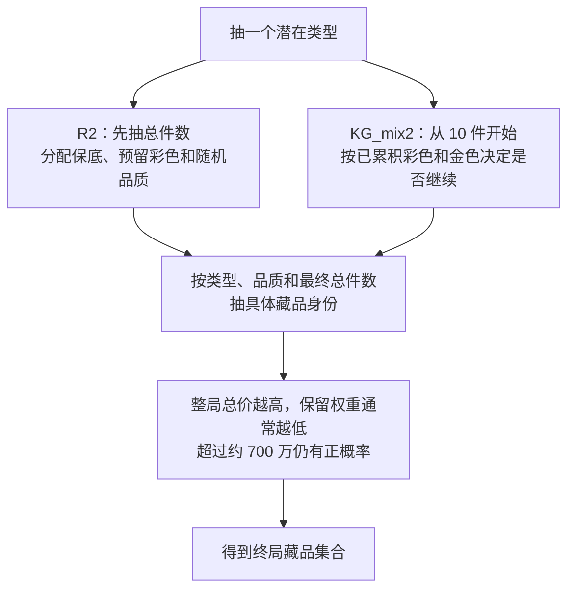

# 地图怎样生成：世界模型的阶段性结果

2026-10-27。汇总独立研究至第 27 轮，并复核早期模型改进实验的生成机制假说。

## 先说结论

**原世界模型仍是有用的估值基线。新研究保留了两个更细的生成模型：它们在旧样本上的点估值几乎打平，但给出的区间更紧，区间评分改善约 10%。** 这足以作为阶段性成果公开，还不足以替换助手先验或认定游戏源码的生成顺序。

研究把三个问题分开：能不能解释已经看到的地图、能不能更好地预测出价前的总价、能不能识别真实生成机制。三者需要不同的证据。

| 问题 | 目前的答案 |
|---|---|
| 彩色为什么在小局更贵、多彩局波动更小？ | 与总件数有关的身份分布，加上整局价值权重，可以同时描述这些现象 |
| 有没有不可越过的 700 万上限？ | 没有这样的数据证据；1,642 局中有 30 局超过 700 万，8 局超过 1,000 万 |
| 新模型估价明显更准吗？ | 点误差没有明确胜出；历史区间评分有改善 |
| 两种生成路径能选出唯一赢家吗？ | 不能；终局评分接近，完整重训的模拟恢复也会混淆 |
| 还要继续在这些旧数据上加机制吗？ | 暂停扩展；保留两个候选，下一步价值更高的是新时间块和过程信息 |

## 数据不是几份独立验证

| 用途 | 样本 | 解释边界 |
|---|---|---|
| 完整终局研究 | 1,642 局、52,909 件、2,561 件彩色 | 私有结算集合；最大总价 11,848,208 |
| 公开严格清洗子集 | 1,284 局 | 全部与私有集合重叠，不能再算外部验证 |
| 生成模型时间比较 | 先前数据训练，后续 987 局分段评分 | 这些历史时间块已反复用于研发 |
| 第 27 轮估值回放 | 2026-08-04 的 74 局、277 个出价前前缀 | 两个新候选用此前 1,556 局训练；整局排除评估对局 |
| 机制恢复 | 每个候选作为真模型生成 20 份数据，共 40 份 | 每份 1,642 局，打乱后 655 局重训、987 局比较；全部为模拟数据 |

公开 v2 参数声明来自 8 月 4 日以前的 1,556 局，但发布文件没有完整训练场次名单。第 27 轮因此保留了这一来源限制。74 局是有可用前缀的已消费历史子集，也不是所有对局的随机样本；这轮没有新的真实盲测。

## 两个候选怎样生成一局

共同起点是白 1、蓝 1、紫 3、金 3 的 8 件保底，以及 10–60 件的总件数范围。两种模型都有两个不可直接观察的类型，用来描述混合分布；这不等于发现了游戏中的两个档位。



**R2：先决定规模，再抽品质。** 类型决定总件数分布和额外品质比例。一个类型不额外预留彩色，另一个类型预留 1 件彩色，其余位置再随机分品质。“不预留”仍可能抽到彩色，“预留 1 件”也不是最多 1 件。R2 的“2”指两个类型，不是重试两次。

**KG_mix2：抽到什么，会影响何时停止。** 8 件保底后先抽 2 件，到达最低 10 件。此后每增加一件，都根据当前总件数、彩色件数和额外金色件数计算停止概率；到 60 件强制结束。它没有把地图格子装满当作停止条件。

**具体身份：保留历史频率，再加价格修正。** 同品质身份的基础概率来自训练数据，并作平滑；再叠加价格曲线和最终总件数的影响。彩色价格曲线可以弯曲，也保留恰好 10 件的单独修正。这不同于“40 种彩色一律等概率”。它能描述小局的特殊分布，但没有解释为什么游戏要这样生成。

**整局价值：使用平滑的概率权重。** 总价经过约 700 万附近时，权重明显下降，但下降后仍留有正概率。高价彩色占去较多总价空间，便可能降低另一个高价彩色共同出现的相对概率，因此无需先设一个独立的“彩色预算”，也能出现预算分摊般的相关性。

公开生成器只输出终局件数、品质数、总价和面积，不重建坐标。既有 10 列、按顺序寻找首个空位的摆放模型是另一层；本次没有新证明真实摆放顺序，也没有把近似行数似然变成精确布局验证。

<details>
<summary>概率定义和公开参数的含义</summary>

令 $z$ 为类型，$N$ 为总件数，$C$ 为品质计数，$I$ 为身份集合，$V$ 为总价。两种候选的终局概率都写成：

$$p(N,C,I) = \frac{1}{Z}\sum_z \pi_z\,p_z(N,C)\,p_z(I\mid N,C)\,a(V,N).$$

这里的 $Z$ 是对整个终局空间的归一化常数，不按观测到的每局品质数分别归一化。公开模拟器从基础分布生成完整集合，再按 $a$ 接受，因而实现同一归一化后的终局分布。这是计算方法，不证明服务器用了拒绝采样。

R2 的 $p_z(N,C)$ 是类型对应的 $N$ 分布乘以扣除保底和预留彩色后的多项分布。

KG_mix2 的停止概率为：

$$h_z(n,k,g)=1-[1-h_{0,z}(n)]\exp(-\lambda_{K,z}k-\lambda_{G,z}g-\lambda_{KG,z}kg).$$

$k$ 是彩色件数，$g$ 是保底 3 件之外的金色件数；$h_0$ 由参数文件的基础 $N$ 分布换算。KG 的最终 $N$ 分布还受到品质停止项影响，不能直接把这个基础分布当作最终规模分布。

两个模型共同的价值权重为：

$$a(V,N)=\epsilon(N)+(1-\epsilon(N))\sigma((T-V)/30000),$$
$$\epsilon(N)=\sigma(b_0+b_1(N-35)/25).$$

$T$ 是拟合参数，不是强制设定的 700 万硬门槛。公开 JSON 中价格单位是游戏价值原单位；身份概率按类型、品质、$N=10,\ldots,60$ 直接给出，并对应公开图鉴编号，无需读取私有身份表。

</details>

## 历史回放：区间更好，点估值打平

三组都使用共同适配器、只由训练集构造的行数似然，以及相同的数值升级规则。所有 831 个预测均产生有效结果；未达到数值稳定标准的 119 个也保留在主评分里，没有删掉困难样本。

下表先在每局内部平均，再给 74 局相同权重。MAPE 越低越好；80% 区间对应 P10–P90。

| 指标 | v2 基线 | R2/BASE/G | KG_mix2/BASE/G |
|---|---:|---:|---:|
| 点估值 MAPE | 15.660% | 15.750% | 15.603% |
| 平均绝对误差 | 62.30 万 | 61.53 万 | 60.69 万 |
| 80% 区间覆盖率 | 87.79% | 84.44% | 83.81% |
| 平均区间宽度 | 268.53 万 | 228.82 万 | 229.04 万 |
| 80% 区间评分 | 299.33 万 | 269.77 万 | 268.21 万 |
| 区间评分相对改善 | — | 9.88% | 10.40% |
| 达到数值稳定标准 | 230/277 | 240/277 | 242/277 |

**区间评分改善是什么意思？** 它同时惩罚区间过宽和漏掉真值。80% 区间评分为“宽度 + 10 × 真值超出区间的距离”。新模型在这些旧局中把区间缩窄，增加的漏出惩罚没有抵消宽度收益，因此总评分降低。它不是准确率提高 10 个百分点，也不是收益率提高 10%。

以局为单位配对自助抽样 1,999 次：KG 相对 v2 的 MAPE 差为 −0.057 个百分点，95% 区间为 [−0.821, +0.761]；R2 为 +0.090 个百分点，[−0.556, +0.814]。两者都跨过零。区间评分差分别为 −31.13 万和 −29.57 万，其区间均低于零。

两次独立随机种子的点误差排名会翻转，区间评分改善方向则一致。R2 与 KG 的点预测相差通常很小：相对差中位数约 1.13%，90 分位约 3.90%，277 个前缀中只有 2 个超过 10%。

这里的置信区间只对已冻结的预测作局级重采样，没有覆盖重新训练、日期间依赖、选模型和全部蒙特卡洛误差。两类候选的累计计算耗时也明显高于 v2；这是离线证据，不是实时性能验收。

此外，回放最高总价为 6,824,814，没有超过 700 万的对局；揭示信息仍有合并、坐标忽略和经验行数似然近似，缺少独立可见时间戳链。不能据此宣称高价尾部出价已验证。

## 机制恢复：即使知道候选家族，也会认错

用冻结的两个候选各生成 20 份原生独立模拟数据，再让两个模型重新估计身份频率和全部参数。训练起点来自固定的早期拟合，不拿生成数据的真实参数当起点。

| 模拟真模型 | 完整重训后选对 | Wilson 95% 区间 | 在同一批测试集上、已知参数时选对 |
|---|---:|---:|---:|
| R2 | 14/20（70%） | 48.10–85.45% | 20/20 |
| KG_mix2 | 19/20（95%） | 76.39–99.11% | 20/20 |

40 份数据对应 80 个重训终点，均通过本轮数值门槛。R2 的两个正确选择对积分差异敏感；把它们视为未确定，正确比例的敏感性范围为 60–70%。两套积分样本的差只是数值诊断，不是严格误差上界。

这说明“拿到真参数能区分”不等于“有限数据重训后一定能区分”。即便选错家族，总件数和平均总价也可能恢复得不错。结果只检验这两个候选、这套估计器、惩罚和固定起点，不证明普遍可识别，更不证明真实游戏属于其中之一。

最初用生成器参数作起点的试跑，以及种子区间冲突的一批试跑，均不计入正式 40 份数据。原始记录保留，正式试验的种子见公开恢复表。

## 哪些解释被修正，哪些问题仍留下

| 早期观察或假说 | 后续结论 |
|---|---|
| 700 万硬上限、超出必重抽 | 改为可检验的正概率总价权重；实际有超限局，无法由终局唯一推断重试次数 |
| 所有彩色近似均匀，只靠总价筛选即可 | 不足；保留经验身份频率、价格曲线和规模关系 |
| 10 件局的高价偏好全由 700 万筛选产生 | 不足；该规模的可达总价范围提供反例，10 件局仍需单独描述，原因未识别 |
| 多彩局需要额外 COUNT/PAIR 相互作用 | 在完整 BASE/G 上没有稳定增量；弱 U 对照有局部改善，但仍落后 BASE/G |
| 固定 N 重抽与重新抽 N 可以凭终局排序唯一确定 | 基础规模分布可调整时可能等价；不能把拟合略好写成源码顺序 |
| 某些价位缺口说明明确禁止生成 | 证据不足，不设硬禁区或“两件高价彩色绝不共存”的规则 |

第 26 轮中，R2 的 COUNT/U、PAIR/U 和 KG 的 PAIR/U 通过了原本的相对 U 分数筛选，但仍比各自已有 BASE/G 少约 65–81 个对数评分单位。没有为这些弱分支追加原计划的 99 次重训，是看到结果后的研究价值判断，不能改写为预注册停止条件，也不能说这些修正全部被原门槛否决。

尾部仍有残差：后续 987 局里 13 局超过 700 万，两种完整候选都预计约 23.4 局；N=60 的彩色件数和单价也偏高。训练不确定性不小，因此这些点差说明还有问题，却不能单凭点预测把整个机制判死刑。两个保留候选在完整历史联合评分上的差约 1.61，尚不能唯一择优。

下一阶段只保留能改变判断的问题：新时间块能否复现区间收益、尾部是否校准、过程信息能否打破终局等价。现有资料中没有找到新的有效结算，不再把同一批历史数据改名为新验证。

## 怎样复核这次发布

这次整理覆盖两个研究目录的最终成果；早期推理实现已经合入助手，旧的生成假说按后续证据修正。未把全部中间缓存、失败日志和私有原始数据打包为公开仓库。

| 层次 | 公开内容 | 能复核什么 |
|---|---|---|
| 候选生成 | [参数与模型卡](../models/research-world-model-stage-20261027/MODEL_CARD.md)、NumPy 生成器 | 件数概率归一化、生成规则、正概率尾部、模拟分布 |
| 冻结统计 | [结果包](../results/world-model-stage-20261027/README.md)、40 次恢复明细 | 表格、相对改善、成功计数、数值不稳定数量、来源摘要哈希 |
| 完整重训和历史后验回放 | 本地研究封存；公开方法和结果 | 依赖未公开结算及前缀，无法仅凭本仓库完整重跑；公开数据是重叠子集 |

从仓库根目录安装研究包后运行：

```bash
python -m auction_moment_research.research_world_model --model models/research-world-model-stage-20261027/R2.json --worlds 10000 --seed 20261027
python -m auction_moment_research.research_world_model --model models/research-world-model-stage-20261027/KG_mix2.json --worlds 10000 --seed 20261027
python scripts/verify_staged_research.py
```

这两个命令产生新的模拟摘要，不应期待逐项等于历史数据，也不复现 40 次完整重训。参数导出已与原适配器比较：件数联合概率最大绝对差小于 1.4×10⁻¹⁶，价值权重最大绝对差小于 1.9×10⁻¹⁵；身份概率直接取同一冻结数组，按公开图鉴重排。

本报告优先于早期关于硬上限和重试顺序的解释。原 v1 生成报告作为历史版本保留。本次没有修改助手默认模型，没有发布新模型安装包，也没有完成实盘、前瞻校准或收益验证。
